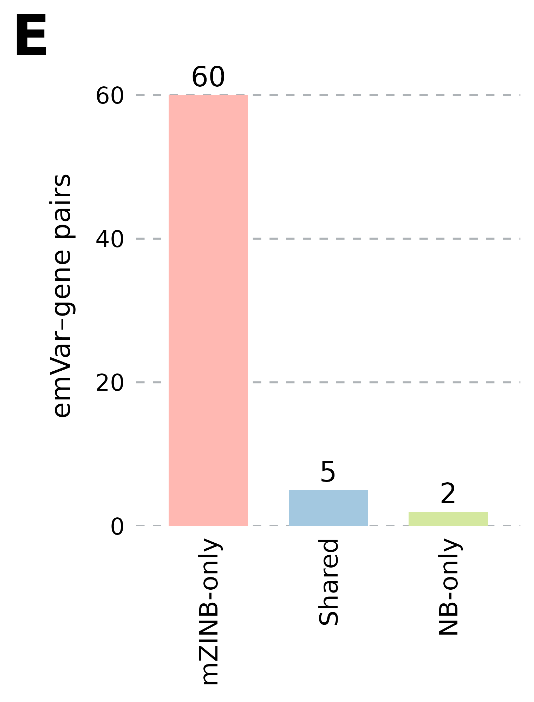
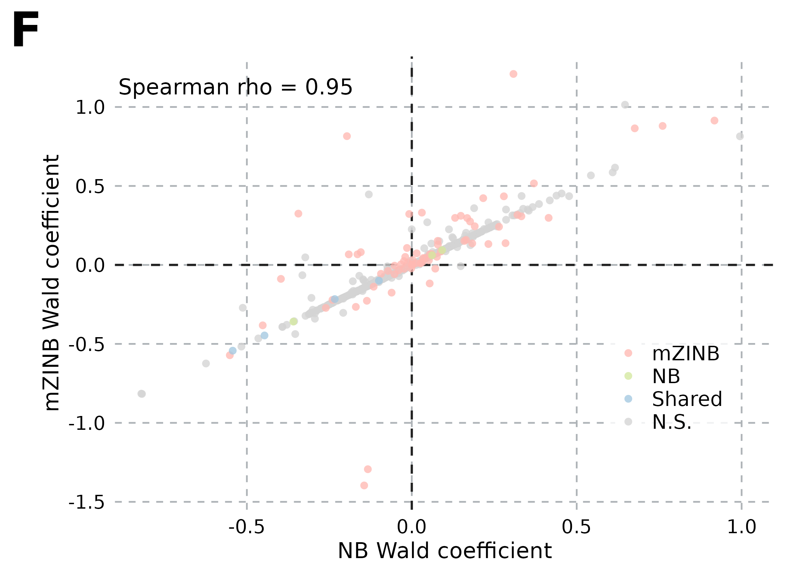
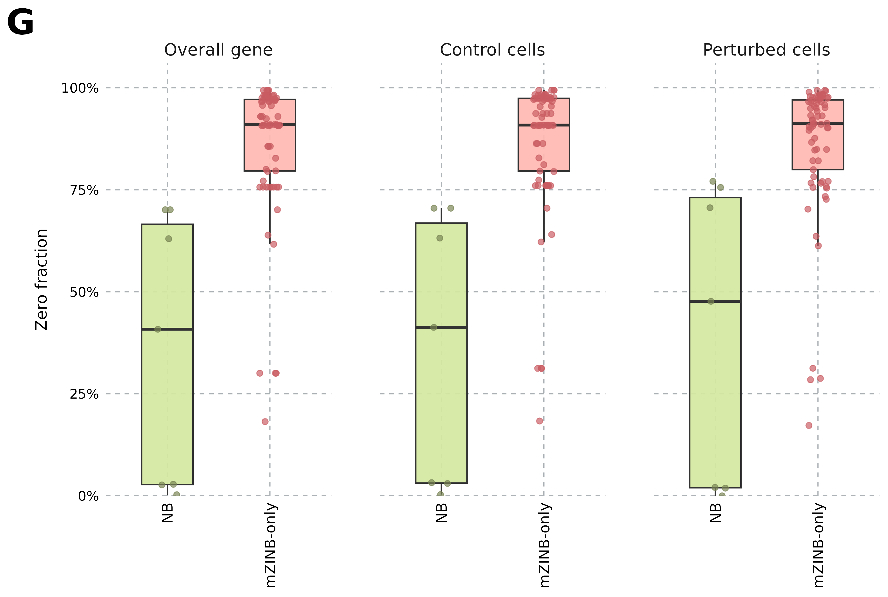
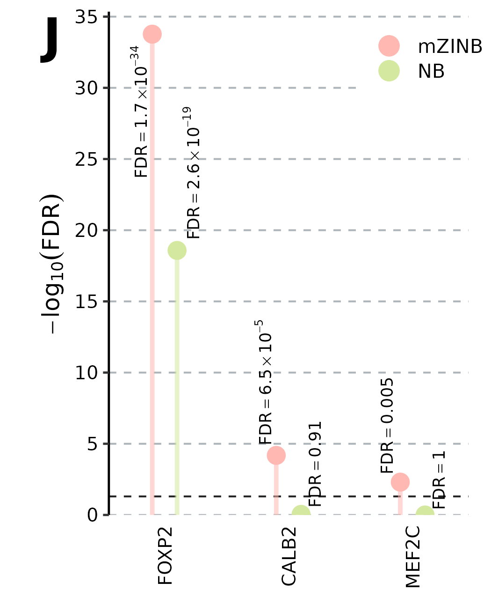

# Why we tried mZINB: a biological case study

*Draft · October 30, 2026 · Existing Figure S5 analysis*

## The question

Can modeling zero inflation change what we detect while preserving an interpretable marginal-mean effect? Figure S5 from our submitted biological study provides a concrete example.

## Similar effects, different discoveries

The reported discovery sets contained **60 mZINB-only emVar–gene pairs, 5 shared pairs, and 2 NB-only pairs**. These are discoveries under the study's analysis pipeline, not a count of known true positives.

Effect estimates were largely concordant: among **791 common eligible guide-level tests**, Spearman correlation was **0.950**, and 769/791 estimates had the same direction. The individual eligible sets contained 792 mZINB and 825 NB tests. Discovery pairs and guide-level tests are different units, and the eligible sets are not identical.

The detected pairs also occupied different sparsity ranges. This motivated us to examine sparse genes more closely; a comparison restricted to discoveries does not by itself establish detection power.

## Positive controls give the comparison context

The study's positive-control analysis reported the following adjusted values:

| Target | mZINB FDR | NB FDR |
|---|---:|---:|
| FOXP2 | 1.70e-34 | 2.63e-19 |
| CALB2 | 6.54e-5 | 0.910 |
| MEF2C | 0.00494 | 1.000 |

Both methods detected FOXP2. CALB2 and MEF2C were detected by mZINB but not NB under the study's significance criterion. These controls are a useful reason to investigate mZINB further, rather than relying only on the total number of discoveries.

## What this supports—and what remains open

This dataset illustrates why we used mZINB: broadly concordant effects, additional sparse discoveries, and useful positive-control results. It does not establish universal superiority, empirical FDR control, or superiority to every other DEG tool. Those are separate benchmark questions.

This is the submitted analysis, not a rerun with current development settings. In particular, the Figure S5 filtering display used a minimum of five nonzero cells per condition; the newer sparse-data pilot uses ten. We retain that distinction.

One open optimization issue is worth recording. Figure S5H's original summary had a lower mZINB full likelihood in 17.7% of the 440 paired variant–gene summaries. The exact data/design matching and optimization history need auditing before interpreting that difference: under an otherwise matched unpenalized fit, the NB limit should be available to mZINB. Higher in-sample likelihood alone would not establish better inference either.

Next: [Is a high zero fraction enough?](sparse-regimes.md)

[Source details](sources.md#figure-s5)
