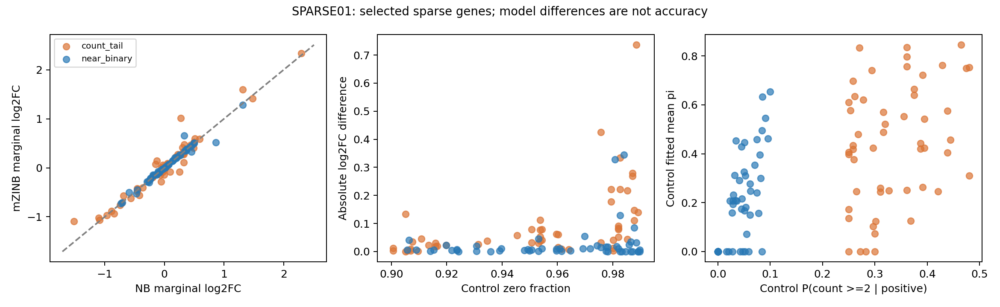

# Is a high zero fraction enough?

*Draft · October 30, 2026 · SPARSE01 real-data pilot*

## A question the overall average can hide

A broad NB–mZINB comparison may say little about very sparse genes. But even within sparse genes, almost-binary counts and occasional larger positive counts can provide different information.

We therefore revisited an author-provided Microglia dataset, using the author's RNA counts and guide assignments. Three perturbations—CDK8, TGFBR2 and INPP5D—were each compared with non-targeting controls.

## A deliberately focused sample

We required at least **10 nonzero cells in each condition**, a control mean count no greater than **0.5**, and a control zero fraction between **90% and 99%**. Within each zero-fraction interval we sampled two contrasting groups:

- **Near-binary:** no more than 10% of positive control counts were at least 2.
- **Count tail:** at least 25% of positive control counts were at least 2.

These are exploratory strata, not validated model-switching thresholds. Intermediate cases were omitted from this contrast. We selected up to six genes per stratum and perturbation, producing **107 target–gene comparisons**; repeated genes and shared controls are not independent biological replicates.

NB and mZINB used the same cells, mean design (perturbation and lane), and library-size offset. The LRT tested the marginal-mean perturbation coefficient. The mZINB zero perturbation effect remained free in both null and alternative models.

## Where the estimates differed

Both models passed the specified numerical diagnostics in all 107 comparisons. The median absolute difference between their marginal log2 fold-change estimates was:

| Control zero fraction | Near-binary | Count tail |
|---|---:|---:|
| 90–95% | 0.0052 | 0.0210 |
| 95–98% | 0.0101 | 0.0572 |
| 98–99% | 0.0083 | 0.1109 |

Each cell contains 18 comparisons, except the final count-tail cell, which contains 17.

Differences were larger in the count-tail group, especially at the highest sparsity. **A larger difference does not tell us which estimate is more accurate.** That requires ground truth or independent validation.

## Numerical convergence is not identifiability

The full mZINB Hessian passed our practical regularity checks in **0/54 near-binary** comparisons and **21/53 count-tail** comparisons. The checks required minimum eigenvalue >1e-8 and condition number <1e10; they are diagnostics, not a theorem about identifiability.

This is consistent with our interest in the positive-count distribution, rather than zero fraction alone. A nonregular full Hessian also does not automatically invalidate inference for the marginal-mean coefficient. Nominal p-values from this pilot have not been calibrated, and we do not claim FDR or power gains from them.

## What comes next

A separate 9,000-dataset simulation has completed automated aggregation. Its interpretation is still under review. It uses independent known-DGP null calibration and evaluation samples; this is **not** fitted-null bootstrap validation on real data. We will add reviewed error-rate, power and coefficient-error results here.

[Model-choice outline](model-choice.md) · [Source details](sources.md#sparse01)
